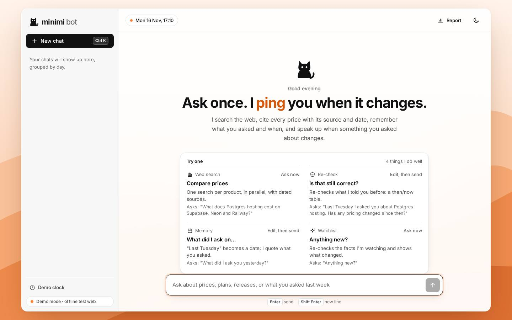
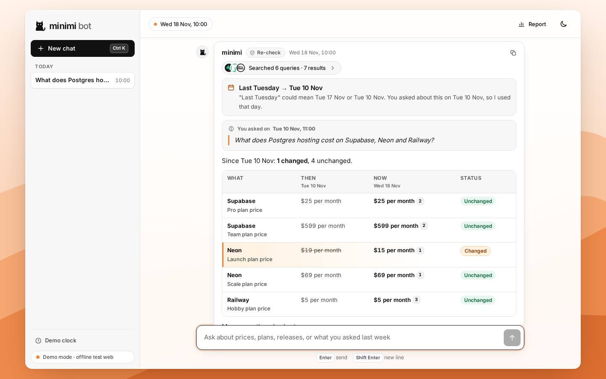
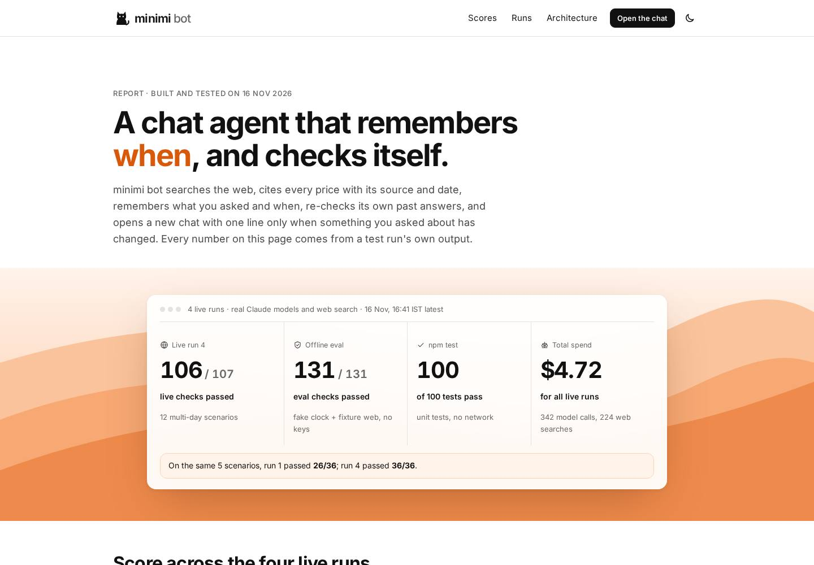
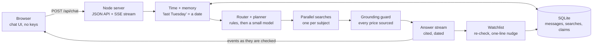
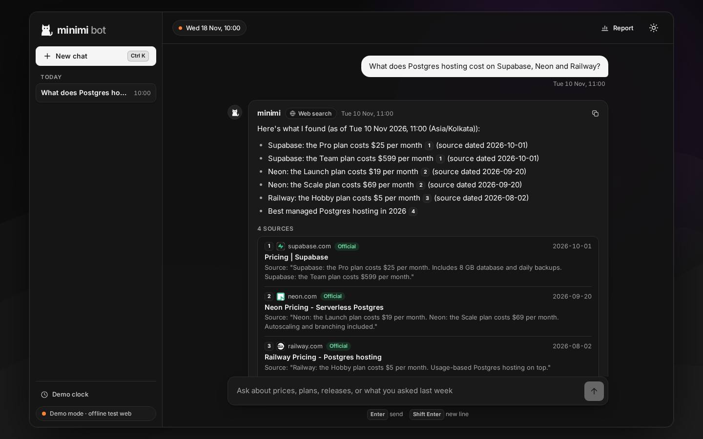

# minimi bot

A chat agent that searches the web, remembers **what you asked and when**, re-checks its own past answers, and
pings you with one line only when something you asked about has actually changed.

## Quick start

1. `npm install` (Node 22.13 or newer, no native build step)
2. `cp .env.example .env` and set `ANTHROPIC_API_KEY` (optional: `TAVILY_API_KEY` for faster search)
3. `npm run dev` and open http://localhost:3000

**No key? It still runs.** Without a key the app starts in fake mode: a deterministic model, a small offline test
web and a demo clock in the sidebar. Try memory across days: ask "What does Postgres hosting cost on Supabase, Neon
and Railway?" with the clock on 10 Nov, move it to 18 Nov, then ask "Last Tuesday I asked you about Postgres hosting.
Has any pricing changed since then?". The report page is at http://localhost:3000/report.

## What makes it different

- **Memory with dates.** Every message is stored with its time. "Yesterday", "last Tuesday" or "on the 3rd" become
  dates in code, and the answer shows how it read them ("Last Tuesday = Tue 10 Nov") and quotes what you asked then.
- **Re-verification.** Facts from answers are saved as rows (product, plan, price, source, date). "Is that still
  correct?" re-checks exactly those facts and shows a then/now table with Changed and Unchanged per row.
- **Grounding in code.** One web search per product runs in parallel, and the answer model writes only from those
  sources. While it streams, a guard checks every price against the sources; a price no source backs is shown as
  "(unverified)", never as fact.
- **The right moment.** Facts you asked about form a watchlist. A new chat quietly re-checks the ones older than 3 days and
  opens with one line only if something changed. No change, no message.

## Report: how well it works

Four live runs on 16 Nov 2026 with the real models (Claude Opus 5.5 for answers, Claude Haiku 5.5 for routing,
search and reading values) and Claude web search. After each run we fixed what failed and ran again. Run 4 added
7 new scenarios (late-night time phrases, same-day recall, small talk, no-search questions, price formats, prompt
injection in search results, a watchlist where nothing changed).

| Run | Scenarios | Live checks passed | Spend | Model calls | Web searches |
|---|---:|---:|---:|---:|---:|
| 1 | 5 | 26 / 36 (72%) | $1.28 | 43 | 56 |
| 2 | 5 | 30 / 36 (83%) | $0.95 | 81 | 49 |
| 3 | 5 | 33 / 36 (92%) | $0.96 | 80 | 49 |
| 4 | 12 | **106 / 107 (99%)** | $1.53 | 138 | 70 |

- On the 5 scenarios of run 1, run 4 passed **36 / 36**.
- The one run-4 miss was the check, not the agent: naming the 23:40 question as last night's context is correct, but
  the check failed on any mention of it. The check is now precise (commit `9aef87d`).
- Offline: **131 / 131** eval checks (12 multi-day scenarios on a fake clock) and **127 / 127** tests in `npm test`.
- Total live spend for all four runs: **$4.72**.
- Medians in run 4: a web-search answer starts after 12.8 s and finishes in 19.6 s; a memory answer finishes in 2.9 s
  (its date reading and quoted question appear at once).

The in-app report at **[/report](http://localhost:3000/report)** has the score timeline, every failed check per run
with the commit that fixed it, a scenario-by-scenario table, latency by question type, the architecture and the
security notes.

Every number comes from the run files in [`eval/live-reports/`](eval/live-reports): `npm run report` rebuilds
`public/report/data.json` from them, cross-checks each run's result file against its console log, verifies the
commits in [`CHANGELOG.json`](eval/live-reports/CHANGELOG.json), and reruns the offline eval and tests.

## Architecture

- **Server:** plain `node:http`, a JSON API and one Server-Sent-Events stream; no framework.
- **Agent:** the plain Anthropic SDK, so every prompt and step is visible and testable. Search sits behind an
  interface (Tavily, or Claude web search with only an Anthropic key).
- **Memory:** one SQLite file built into Node 22 (FTS5 for keywords, time windows for dates).
- **Web UI:** plain ES modules and CSS, no build step, light and dark, works at 360 px. Site logos come through the
  server's own logo proxy, so the browser never calls a third party.

More in [DESIGN.md](DESIGN.md) (one page), the [High-Level Design](docs/HLD.md) (requirements, components, request
lifecycles, security, cost, scaling, trade-offs), the [Low-Level Design](docs/LLD.md) (module by module: algorithms,
schema, stream events, errors, configuration, test map) and [EXPLAIN.md](EXPLAIN.md).

## Testing

| Command | What it does |
|---|---|
| `npm test` | 127 tests: unit tests and the offline scenarios (no network, no keys) |
| `npm run eval` | The multi-day eval with a readable report: 131 checks offline (`EVAL_VERBOSE=1` prints answers) |
| `npm run eval:live` | The same scenarios against the real models and web search, capped at `MAX_SPEND_USD` (default $5) |
| `npm run report` | Rebuilds the report data from `eval/live-reports/` and the offline runs |
| `npm run typecheck` | `tsc --noEmit`, strict |
| `npm run chat` | The same agent in the terminal (`/new`, `/time <ISO date>`, `/quit`) |

Programmatic use: `import { createAgent } from "./src/index.ts"` (see the comment at the top of that file).

## Security

No API keys reach the browser. Cross-site POSTs are refused. The logo proxy fetches only public https addresses,
caps size and time, and serves sniffed images with a strict content policy. Search results are treated as data:
injected instructions are ignored (tested live). The markdown renderer escapes everything before adding its own tags.

## Credits

Built by Anant Vardhan Pandey for minimi. The look follows minimi's own site; the cat mark is our own drawing.
