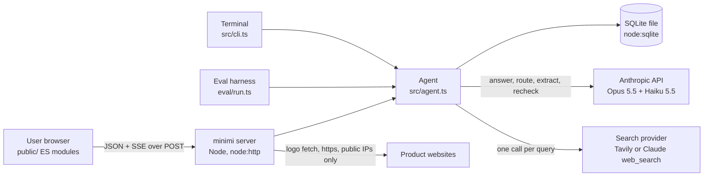
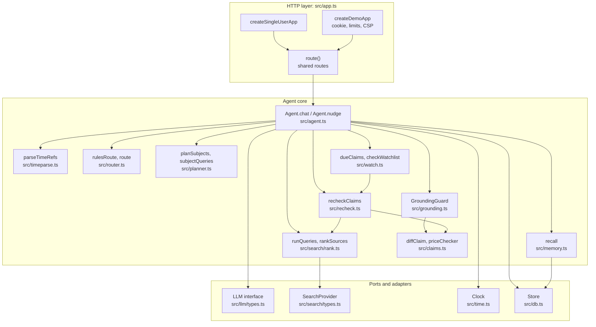
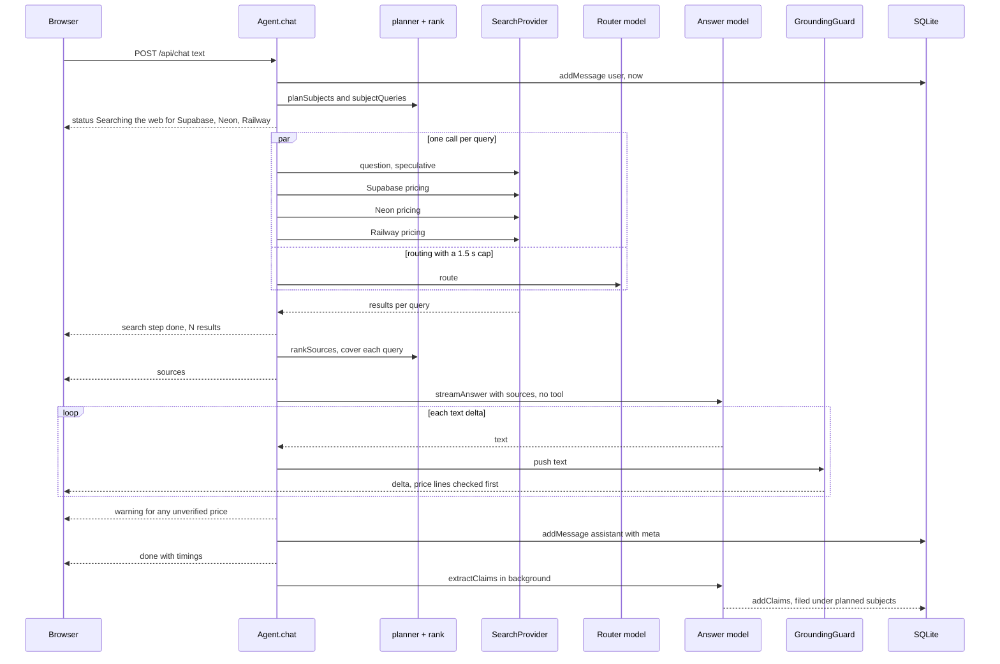
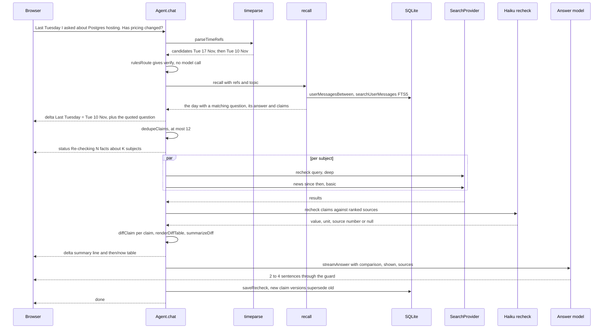
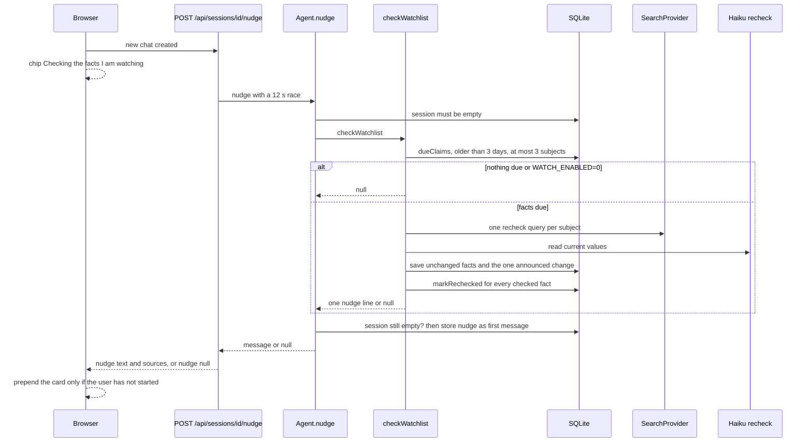
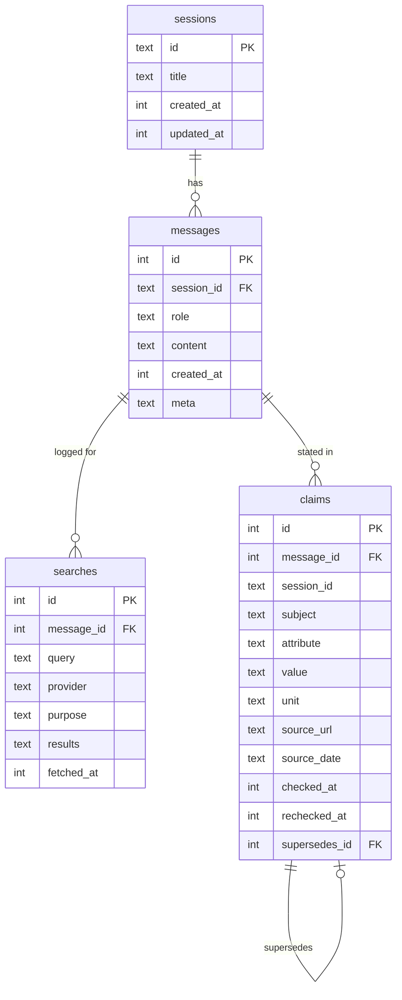
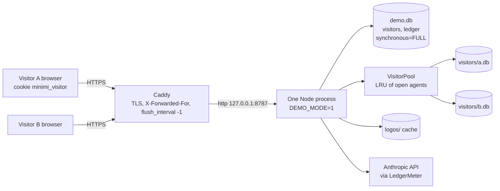

# minimi bot: High-Level Design

Status: describes the code on branch `docs/hld-lld` (fixes, glass UI and hosted demo merged).
Companion documents: [LLD.md](LLD.md) (module by module), [DESIGN.md](../DESIGN.md) (one-page summary),
[deploy/README-demo.md](../deploy/README-demo.md) (demo runbook).

Every component below names the file and function that implements it. Numbers marked **measured** come from
`eval/live-reports/` or `public/report/data.json`. Numbers marked **target** are design goals, not measurements.

---

## 1. Problem

A chat agent with one tool, web search, that remembers **what the user asked and when**. Three questions from the
brief define it:

1. "What does Postgres hosting cost on Supabase, Neon and Railway?" (a fresh web question, a comparison).
2. "Last Tuesday I asked you about Postgres hosting. Has any pricing changed since then?" (memory with a date, then
   a re-check).
3. "What did I ask on 3 November, and is it still correct?" (recall by date, then verification).

The hard parts are not the chat. They are: resolving "last Tuesday" to a real date, finding the right earlier
conversation, knowing exactly which facts were stated then, re-checking only those facts, and never showing a price
as fact when no current source backs it.

## 2. Goals and non-goals

### Goals

| # | Goal | Where it lives |
|---|---|---|
| G1 | Answer web questions from current sources, with citations and dates | `src/agent.ts` `Agent.chat`, `src/search/*` |
| G2 | Remember every message with its time; resolve time phrases in code | `src/db.ts`, `src/timeparse.ts` `parseTimeRefs` |
| G3 | Recall earlier conversations by date and topic | `src/memory.ts` `recall` |
| G4 | Re-verify earlier facts and show a then/now table | `src/recheck.ts`, `src/claims.ts` `diffClaim`, `renderDiffTable` |
| G5 | Ground every price to a source, enforced in code while streaming | `src/grounding.ts` `GroundingGuard`, `src/claims.ts` `priceChecker` |
| G6 | Speak up at the right moment: one line when a watched fact changed, silence otherwise | `src/watch.ts` `checkWatchlist` |
| G7 | Show progress at once; first status line before any model call | `src/agent.ts` (speculative search, `Updates`) |
| G8 | Run with no key (fake mode) and be testable offline, including multi-day flows | `src/llm/fake.ts`, `src/search/fake.ts`, `src/time.ts` `FakeClock` |
| G9 | A hosted demo that is safe to put on the public internet | `src/app.ts` `createDemoApp`, `src/demo/*` |

### Non-goals

- Accounts, login, or multi-device sync. The single-user app is one person on one machine. The demo identifies a
  browser by a signed cookie, nothing more.
- Reading full web pages. The agent works from search snippets and quoted passages (see Roadmap).
- Push notifications or a background scheduler. Nudges run when the user opens a new chat.
- General tool use. Web search is the only tool, by design of the brief.
- Semantic (embedding) recall. Recall is time window plus FTS5 keywords.

## 3. Requirements

### 3.1 Functional

| ID | Requirement |
|---|---|
| F1 | Store each user and assistant message with an epoch-ms timestamp (UTC), show it in the user's timezone. |
| F2 | Resolve "yesterday", "on Monday", "last Tuesday", "3 November", "the 3rd", "two weeks ago", "last night" and similar phrases to local calendar ranges without a model call. |
| F3 | Route each message to one of five intents: `chat`, `search`, `recall`, `verify`, `updates`. |
| F4 | For a comparison, search once per named product, in parallel. |
| F5 | Store checkable facts ("claims") from answers: subject, attribute, value, unit, source URL and date. |
| F6 | "Is that still correct?" re-checks the stored claims of the earlier answer and renders a then/now table in code. |
| F7 | "Anything new?" re-checks the watchlist and shows at most 6 rows, changes first. |
| F8 | A new chat may open with one nudge line if a watched fact changed. Never twice for the same change. |
| F9 | Stream the answer with typed events: status, search steps, sources, text, warnings, done. |
| F10 | Mark any price that no current source supports as "(unverified)" before the user sees it. |
| F11 | A stop button aborts the turn; the partial answer is saved and marked aborted; no claims are learned from it. |

### 3.2 Non-functional

| Area | Requirement | Status |
|---|---|---|
| Latency | First status line in under 50 ms after the request (no model call before it). | **measured** run 4: median first status 1 ms for every intent that emits one (recall emits none: its first text is at 1 ms) |
| Latency | Memory answers (recall) feel instant: date reading and quote rendered by code first. | **measured** run 4 recall: first text 1 ms, total 2.9 s median |
| Latency | Web answers: first model token about 1-2 s after the slowest search. | **target**. **measured** run 4 search: first text 12.8 s, total 19.6 s median |
| Cost | Hard spend cap per process (`MAX_SPEND_USD`), and per demo (`DEMO_BUDGET_USD`, persisted). | enforced in `src/usage.ts`, `src/demo/budget.ts` |
| Privacy | API keys never reach the browser. Demo visitors never see each other's data. | `src/app.ts`, `test/demo.test.ts` "isolation" |
| Correctness | No price shown as fact without a source. Checked independently of the guard in the eval. | `eval/scenarios.ts` check "no price shown as fact without a source" |
| Correctness | A re-check never says "nothing changed" unless every fact was verified. | `src/claims.ts` `summarizeDiff` |
| Reliability | A slow router, failed search or failed model call degrades the answer, never hangs or crashes the turn. | section 12 |
| Testability | The whole multi-day flow runs offline and deterministically in `npm test`. | `test/agent.test.ts` runs every eval scenario |
| Portability | Node 22.13+, no native build step, two runtime dependencies (`@anthropic-ai/sdk`, `tsx`). | `package.json` |

## 4. System context

Three front ends drive the same `Agent` class: the HTTP server (`src/server.ts` → `src/app.ts`), the terminal
(`src/cli.ts`) and the eval (`eval/scenarios.ts` `runScenario`). The programmatic entry point is
`src/index.ts` `createAgent`.

## 5. Components

| Component | File, entry points | Responsibility |
|---|---|---|
| HTTP app | `src/app.ts` `createApp`, `route`, `handler` | Static files, JSON API, SSE chat stream, Origin and content-type checks, typed `HttpError`. One fork point: `Mode.ctx(req)` returns the caller's agent. |
| Hosted demo | `src/app.ts` `createDemoApp`, `src/demo/*` | Per-visitor agent and SQLite file, signed cookie, budget ledger, rate limits, security headers, TTL sweep. |
| Agent | `src/agent.ts` `Agent.chat`, `Agent.nudge` | Orchestrates one turn as an async generator of `AgentEvent`. Owns the search plan. |
| Time | `src/time.ts`, `src/timeparse.ts` | Injectable clock; civil dates in the user's zone; time-phrase resolution to candidate ranges. |
| Router | `src/router.ts` `rulesRoute`, `route`, `ownQuestion`, `fallbackRoute` | Rules first; small model only when rules are unsure; fallback on timeout. |
| Planner | `src/planner.ts` `planSubjects`, `subjectQueries`, `canonicalSubject`, `fairCap` | Reads the products of a comparison from the text; one query per product; files claims under the searched names. |
| Search | `src/search/{tavily,anthropic,fake}.ts`, `rank.ts` | One provider call per query, in parallel; merge, score and rank; keep each product's best page. |
| Memory | `src/memory.ts` `recall`, `toPastTurn` | Time window plus FTS5 keywords; picks between ambiguous date readings; code-rendered date line and quotes. |
| Claims | `src/claims.ts` | Value parsing and comparison, then/now diff, table rendering, honest summary, the price checker. |
| Grounding guard | `src/grounding.ts` `GroundingGuard` | Holds a sentence or table row that has a price until it is complete, checks it, marks unsupported prices. |
| Re-check | `src/recheck.ts` `planRecheckQueries`, `recheckClaims`, `saveRecheck` | Targeted searches for stored claims, small-model value reading, diff in code, new claim versions. |
| Watchlist | `src/watch.ts` `dueClaims`, `checkWatchlist`, `rowsToShow` | Which facts are due, at most N subjects; one nudge or none. |
| LLM | `src/llm/types.ts` `LLM`; `anthropic.ts`, `fake.ts`, `prompts.ts` | Four narrow jobs: `route`, `streamAnswer`, `extractClaims`, `recheck`. All prompts in one file. |
| Spend | `src/usage.ts` `UsageMeter`, `src/demo/budget.ts` `LedgerMeter` | Price every call, enforce a cap before every paid request. |
| Logos | `src/logo.ts` `LogoService`, `httpsFetcher`, `publicOnlyLookup` | SSRF-safe server-side favicon fetch with disk and memory cache; letter tile fallback. |
| Brand book | `src/brand.ts` `BrandBook` | Maps a query to the product's own domain for step logos; learns from official results. |
| Web UI | `public/js/*` | No-build ES modules: `api.js` (fetch, SSE parser, `ApiError`), `state.js` (store), `chat.js` (controller), `render/*` (views). |
| Report | `eval/report.ts`, `public/report/`, `public/js/report.js` | Builds `data.json` from the live run files and offline runs; the `/report` page draws it. |

## 6. Request lifecycle per intent

Every turn starts the same way in `Agent.chat` (`src/agent.ts`):

1. Trim the text to 4,000 characters (`MAX_INPUT`). Save the user message with `clock.now()`. Emit `turn`.
2. `parseTimeRefs(text, now, tz)` returns time references and `rest` (the text without them).
3. Load the last 8 messages of the session as history (`HISTORY_TURNS`).
4. `rulesRoute` runs. If the rules return `null` or `search`, the message is treated as a likely web question:
   `planSubjects` reads product names and a **speculative** search plan starts at once (the raw question plus one
   query per product). The status line and one `search` step per query are emitted before any model call.
5. `route` asks the small model only when the rules are unsure, with a 1.5 s cap while speculative searches run
   (4 s otherwise). On timeout or error, `fallbackRoute` decides.
6. If the final intent is not `search`, the speculative searches are aborted and their steps marked `cancelled`.
7. Evidence is gathered per intent (below). Code-rendered lines (date reading, quotes, table) are emitted as
   `delta` events before the model writes.
8. `llm.streamAnswer` streams text through the `GroundingGuard`. Unsupported prices are marked and warned.
9. The assistant message is saved with meta (intent, sources, warnings, timings, aborted). A re-check is saved as
   new claim versions. For new answers, `llm.extractClaims` runs in the background.
10. Emit `done` with timings.

### 6.1 Chat and small talk

Rules match greetings, "who made you", arithmetic ("What is 17% of 2,340?") and definitions of single words
(`CHITCHAT`, `MATH`, `DEFINE` in `src/router.ts`). No search starts. The answer model runs with effort `low`, no
sources and no tool. Measured run 4 chat: first text 1.0 s, total 2.9 s (median).

### 6.2 Search

Key choices:

- Code owns the plan. The router model only adds queries when code found no product list
  (`extra` in `Agent.chat`). Live on 16 Nov the router missed its 1.5 s cap and the plan collapsed to one query
  (DESIGN.md, `src/planner.ts` header comment). This is why the plan is not left to the model.
- With only an Anthropic key, each query is one small Haiku call with exactly one `web_search`
  (`src/search/anthropic.ts` `AnthropicWebSearch.search`, `max_uses: 1`), all in parallel.
- `rankSources` with `coverEachQuery` keeps the best page of every query, so no product goes unsourced.
- The answer model gets a `web_search` tool (max `ANSWER_MAX_SEARCHES`, default 3) only when the planned searches
  returned no sources at all (`maxSelfSearches` in `Agent.chat`).

### 6.3 Verify: "is that still correct?"

- The date reading, the quoted question and the table are written by code (`show()` in `Agent.chat`), so they
  never depend on the model's wording. The live answer model often skipped them when only asked to state them
  (`src/memory.ts` header comment).
- The diff is code: `diffClaim` compares money as money (`$19` equals `19 USD`), units by word set, and treats a
  status-only change (`$5 (unverified)` then, `$5` now) as **Unchanged, now confirmed**.
- If the earlier answer has no stored claims: small talk gets a code-written "nothing factual to re-check" reply
  with no search; otherwise the earlier question is searched again and the model compares.

### 6.4 Recall: "what did I ask on 3 November?"

Rules route it to `recall` (`RECALL` regex). `recall()` resolves the window, ranks by FTS5 inside it, and the code
emits the date line and the quoted question. The answer model writes with effort `low`, no sources and no tool,
and an earlier answer can back a price fully here (it is history, not a claim about today). Measured run 4 recall:
first text 1 ms, total 2.9 s (median).

### 6.5 Updates: "anything new?"

Rules only (`UPDATES` regex; the router model's schema has no `updates` intent). `dueClaims(force=true)` takes
every tracked fact, bounded to `WATCH_MAX_SEARCHES` subjects (default 3). `recheckClaims` runs one query per subject
plus one news query per subject. Every fact is re-checked and saved; `rowsToShow` shows at most 6 rows, changes
first, and a line counts the rest.

### 6.6 Nudge on a new chat

"Never twice" is a data property: the announced change is written as a new claim version that supersedes the old
one, so the next check compares against the new value. Other changes found in the same check stay unsaved, so
"anything new?" still reports them. Facts that were checked but not confirmed get `rechecked_at`, so they are not
searched again for `WATCH_AFTER_DAYS`.

## 7. Data model overview

One SQLite file per user (`DB_PATH`, default `data/minimi.db`; in the demo, `DATA_DIR/visitors/<id>.db`). Full
schema in [LLD.md section 3](LLD.md#3-sqlite-schema).

- Time is epoch milliseconds (UTC). Display and day boundaries use `USER_TIMEZONE` (default `Asia/Kolkata`).
- `messages_fts` is an FTS5 external-content index over `messages.content`, kept current by triggers.
- A claim's history is a chain through `supersedes_id`. The head of each chain (no claim supersedes it) is the
  current belief; `Store.rootClaim` walks back to the answer the user originally saw.
- The demo adds `DATA_DIR/demo.db` with `visitors` and a one-row `ledger` (`src/demo/registry.ts`).

## 8. Streaming protocol overview

`POST /api/chat` with `{sessionId?, text}` returns `text/event-stream`. Each frame is `data: <json>\n\n`. Events
(`AgentEvent` in `src/agent.ts`):

| Event | When |
|---|---|
| `turn` | First. The saved user message id and its time label. |
| `status` | Human progress lines ("Searching the web for ...", "3 results for ... (2 of 4 searches done)"). |
| `search` | One search step: `running`, `done` (with `results`, `domain`), `failed` or `cancelled`. |
| `route` | The chosen intent, how it was chosen (`rules`, `model`, `fallback`) and the queries. |
| `sources` | The numbered source list (sent again when the model's own search adds sources). |
| `delta` | Answer text: code-rendered lines first, then model text released by the guard. |
| `warning` | All searches failed, or a price could not be matched to a source. |
| `error` | The model failed mid-answer; the demo adds `code: "demo_budget"` and `final`. |
| `done` | Last. Saved assistant message id, time label and `timings`. |

The browser parses frames with `createSSEParser` (`public/js/api.js`); unknown event types are ignored, so old
pages and new servers interoperate. A stream that ends without `done` (or a `final` error) becomes
`ApiError("cut")` and the partial answer stays on screen. Examples in [LLD.md section 4](LLD.md#4-stream-events).

## 9. Hosted demo topology

- `before()` in `createDemoApp` sets security headers, takes a per-IP request token, checks the optional access
  code, and verifies or issues the visitor cookie (`src/demo/cookie.ts`).
- `ctx(req)` maps the visitor id to `VisitorPool.get(id)`: their own `Agent`, `Store` and `FakeClock`, opened
  lazily, LRU-evicted when idle beyond `DEMO_OPEN_VISITORS` (200).
- One `LedgerMeter` is shared by all visitors. It writes every call's cost to `demo.db` at once and refuses paid
  calls when the ledger reaches `DEMO_BUDGET_USD` (default $18). A new message also needs
  `spent + (running + 1) × DEMO_TURN_RESERVE_USD ≤ budget`.
- Limits: 40 messages per visitor per day (reset at midnight in `USER_TIMEZONE`), 10 messages and 240 requests per
  IP per minute, one answer per visitor, 8 answers server-wide, 2,000-character messages, 16 KB bodies, 120 s per
  answer, 500 visitors. A visitor's data is deleted `DEMO_TTL_DAYS` (7) after their last visit.
- It must run as **one process**: the stream counters and token buckets live in memory (the ledger survives
  restarts). Runbook: `deploy/README-demo.md`; proxy config: `deploy/Caddyfile.demo`.

## 10. Security model

| Threat | Control | Code |
|---|---|---|
| Key leakage | Keys are read from the environment on the server only. The browser never sees them; `/api/health` reports names of models, not keys. Demo errors are replaced by a generic line (`publicError`). | `src/config.ts`, `src/app.ts` `createDemoApp` |
| Cross-site spending (CSRF) | Every POST must have `content-type: application/json` (forces a CORS preflight that is never answered) and, if an `Origin` is sent, its host must equal `Host`. | `src/app.ts` `route` |
| Visitor impersonation | 128-bit random id plus HMAC-SHA256 tag, constant-time compare, HttpOnly, SameSite=Lax, Secure behind HTTPS. A forged cookie becomes a new empty visitor. Key rotation via `DEMO_COOKIE_SECRET_PREVIOUS`. | `src/demo/cookie.ts` |
| Path traversal | Visitor ids must match `^[0-9a-f]{32}$` before naming a file. Static files must resolve inside `public/`. | `VisitorPool.pathFor`, `route` |
| SSRF via logos | Hostnames only (no IP literals, ports, local suffixes), https only, every DNS answer must be public, checked inside `lookup` at connect time (no DNS rebinding), 3 redirects, 4 s timeout, size caps, raster images sniffed from bytes (SVG refused). | `src/logo.ts` `cleanDomain`, `publicOnlyLookup`, `httpsFetcher`, `sniffImage` |
| Prompt injection from web pages | Search text is data inside `<sources>`; tag-like text that could close or open prompt sections is defanged; the system prompt says page instructions are ignored. Grounding is enforced in code, so an injected price still needs a source. | `src/llm/prompts.ts` `defang`, `ANSWER_SYSTEM`; eval scenario `prompt-injection-in-results` |
| XSS from model text | `markdown.js` escapes every character first, then adds its own tags; links must be http(s); citations link only to listed sources. `dom.js` inserts text as text. | `public/js/markdown.js`, `public/js/dom.js` |
| FTS injection | User words are quoted as FTS5 strings (quotes stripped). | `Store.searchUserMessages` |
| Abuse and cost | Spend caps; demo per-visitor daily cap, per-IP token buckets, concurrency caps, message and body caps, server timeouts. | `src/demo/*`, `src/server.ts` |
| Clickjacking, sniffing | Demo: CSP (own origin, inline theme script by SHA-256 hash), `frame-ancestors 'none'`, `X-Frame-Options: DENY`, `nosniff`, `Referrer-Policy: no-referrer`, `Permissions-Policy`, HSTS behind HTTPS. | `createDemoApp` `csp`, `before` |
| Client IP spoofing | `X-Forwarded-For` is used only with `DEMO_TRUST_PROXY=1`, and then only its last entry (the one Caddy appended). | `clientIp` in `createDemoApp` |

Single-user mode binds to `127.0.0.1` by default and sends no CSP or security headers (it is a local app). The logo
service sends the domain name, never user text, to the product's site and, as a last resort, to
`icons.duckduckgo.com`.

## 11. Cost model

Prices are in `src/usage.ts` `PRICES` (USD per million tokens, list prices as recorded in the code):

| Model | Input | Output | Used for |
|---|---:|---:|---|
| `claude-opus-5-5` | $4 | $20 | Streamed answers (`ANSWER_MODEL`) |
| `claude-haiku-5-5` | $0.10 | $0.50 | Routing, claim extraction, re-check reading, and the search calls (`FAST_MODEL`, `SEARCH_MODEL`) |
| Web search | $10 per 1,000 searches | | Each Claude `web_search` use |

Cache writes are priced at 1.25× input, cache reads at 0.1× input. An unknown model is priced at Opus-5 rates so
spend is never under-counted. The answer system prompt is marked `cache_control: ephemeral`.

**Measured** (four live runs, 16 Nov 2026, `public/report/data.json`):

| | Run 1 | Run 2 | Run 3 | Run 4 |
|---|---:|---:|---:|---:|
| Scenarios | 5 | 5 | 5 | 12 |
| Spend | $1.28 | $0.95 | $0.96 | $1.53 |
| Model calls | 43 | 81 | 80 | 138 |
| Web searches | 56 | 49 | 49 | 70 |

Total: $4.72, 342 calls, 224 web searches. Derived from run 4 (not separately measured): 70 searches at $0.01 are
$0.70, about 46% of that run's $1.53; across its 39 measured turns the spend is about $0.04 per turn, nudges included.
Web search fees and Opus output tokens dominate; Haiku calls are cheap. The main levers are therefore fewer
searches per turn (subject cap, watchlist cap of 3 subjects) and a shared search cache (Roadmap).

## 12. Failure modes and degradation

| Failure | Behaviour | Code |
|---|---|---|
| Router model slow or failing | 1.5 s cap (speculative) or 4 s; then `fallbackRoute`: search unless the text is 3 words or fewer without "?". Searches already started are not lost. | `route`, `withTimeout` |
| One search fails | Its step is `failed`; others continue; ranking uses what arrived. | `runQueries` catches per query |
| Every search fails | `warning` event, a note tells the model not to state current facts; the guard still marks any price. | `Agent.chat` after gathering |
| Planned searches find nothing | The answer model gets its own `web_search` (max 3) as a bounded fallback loop. | `maxSelfSearches` |
| Re-check model fails | Every row becomes "Couldn't verify"; the summary says so; never "nothing changed". | `recheckClaims` catch, `summarizeDiff` |
| Answer model fails mid-stream | Partial text is kept, a line says it failed, an `error` event is sent, the turn is still saved. | `Agent.chat` catch |
| Model refusal, length limit, pause | A short closing line is appended. Refusals use the API's server-side fallback model first. | `AnthropicLLM.streamAnswer` |
| User presses Stop or closes the tab | Abort signal stops search and model; partial answer saved with `aborted: true`; no claims, no re-check saved. | `route` `/api/chat`, `Agent.chat` |
| Spend cap reached | `BudgetExceededError` before the call; in the demo a typed `demo_budget` error with how to run locally. | `UsageMeter.check`, `LedgerMeter.check` |
| Nudge slow | 12 s race on the server; the chat is never delayed; the nudge simply does not appear. | `/api/sessions/:id/nudge` |
| User types before the nudge returns | The nudge is not stored (session no longer empty) and the client does not prepend it. | `Agent.nudge`, `checkNudge` |
| Logo fetch fails | A generated letter tile; misses cached for 1 day. | `LogoService`, `monogram` |
| Server unreachable or stream cut | Typed `ApiError` (`network`, `http`, `cut`, `agent`) with a Retry button when retrying can help. | `public/js/api.js`, `chat.js` |

## 13. Trade-offs and alternatives

| Decision | Why | Rejected alternative |
|---|---|---|
| No agent framework; plain Anthropic SDK and `node:http` | Every prompt and step is visible, typed and testable. The turn is a readable async generator. | LangChain or similar: hidden control flow, harder to fake in tests. Express: not needed for about ten routes. |
| SQLite via `node:sqlite` | Built into Node 22, no native build, one file per user, transactions and FTS5 for free. The problem is mostly "when", not "what is similar". | A vector DB: embeddings for a problem that is mostly time windows. Postgres: a server to run for a single-user app. |
| Rules-first routing, small model second, speculative search in parallel | Small talk, recall and "still correct?" are matched in microseconds and need no model. A web question does not wait for the router. | Always search: slower and noisy. Router first: adds up to 4 s to every turn. |
| Search plan owned by code | Live, the router missed its budget and the per-product fan-out silently never happened. Code reading "A, B and C" is instant and testable. | Letting the model plan or search on its own every turn: 15-35 s before the first word (live, 16 Nov). |
| One provider call per query | The plan that runs is the agent's; queries run in parallel; every snippet is traceable to a query. | One batched model call with many searches: the model ran its own searches, one after another. |
| Grounding enforced in code, not trusted to the model | A prompt can ask for sourced prices; only a guard makes an unsourced price impossible to show as fact. Checked per clause, per product, with totals. | Trusting citations, or a judge model after the fact (too late: the user already saw the number). |
| Claims as rows, diff in code | Per-fact Changed / Unchanged / Couldn't verify, with the exact stored values in the table. | A model comparing two prose answers: misses changes, invents some. |
| Code-rendered date line, quote and table | Always present and exact, whatever the model writes. | Asking the model to state them: it skipped them live. |
| Nudge on new chat, not a background job | No daemon to run; the check happens at the moment the user is present. | A scheduler and push notifications: more moving parts than the brief needs (Roadmap). |
| Fakes that copy live failures | The multi-day eval runs offline in `npm test` and catches what live runs caught (slow router, model that searches on its own, paraphrased quotes). | Only live tests: flaky and paid. |
| Hosted demo: per-visitor SQLite file | Real isolation with the same code as the single-user app; deleting a visitor is deleting a file. | One shared database with a user column: one bug leaks memory across visitors. Accounts: friction for reviewers. |

## 14. Testing strategy

| Layer | What | Where |
|---|---|---|
| Unit | Time phrases (incl. timezone edges), routing rules, planner, value comparison, diff, price checker formats, guard streaming, markdown escaping, SSE parser, logo safety, cookie signing, token buckets | `test/*.test.ts` |
| Offline eval | 12 multi-day scenarios on a `FakeClock` against `fixtures/world.json` (21 pages whose prices change on known dates), with a deterministic `FakeLLM` that copies live failure modes. 131 checks. Runs inside `npm test`. | `eval/scenarios.ts`, `test/agent.test.ts` |
| Demo integration | Real HTTP server in-process: isolation, tampered cookies, budget persistence across restarts, rate limits, caps, TTL sweep | `test/demo.test.ts` |
| Live eval | Same scenarios with real models and web search; fixture-dependent checks skipped; spend capped by `MAX_SPEND_USD` (default $5); writes latency p50/p95 and spend | `npm run eval:live`, `eval/run.ts`, results in `eval/live-reports/` |
| Report | Rebuilds `public/report/data.json` from the run files, cross-checks each result file against its console log, verifies the commits in `CHANGELOG.json`, reruns offline eval and tests | `npm run report`, `eval/report.ts` |

A key property is checked independently of the guard: "no price shown as fact without a source" re-reads the final
answer text and fails on any unmarked price no source states (`eval/scenarios.ts`).

**Measured:** live run 4 passed 106 of 107 checks (the miss was the check, fixed in commit `9aef87d`); on run 1's
5 scenarios, run 4 passed 36 of 36 versus 26 of 36 in run 1. Offline: 131 of 131 eval checks. `data.json`
records 100 of 100 tests; on this branch `npm test` now runs 113 tests, all passing (the demo tests were added after
the report was built).

## 15. Scaling path

Today: one Node process, synchronous SQLite, in-memory caches and counters. This is right for a single user and for
a reviewer demo of a few hundred visitors.

| Scale | What breaks first | Change |
|---|---|---|
| 1 user (today) | Nothing. | As is. |
| ~1k users (hosted) | One process serialises SQLite calls on the event loop; per-visitor files and LRU are fine; demo counters are in memory. | Keep per-user SQLite but add an index on `searches(message_id)`; move token buckets, stream counters and the ledger to Redis or Postgres so 2-4 processes can run behind the proxy with sticky routing by visitor id. Share a search-result cache keyed by (query, day) across users to cut the largest cost line. |
| ~100k users | File-per-user operations, backups and fan-out; long answers hold sockets; background work competes with streaming. | Postgres as the store (`messages`, `claims`, `searches` with a `user_id`; `tsvector` for keyword recall; `pgvector` for paraphrased recall). Stateless API processes. A queue (for example SQS or a Postgres-backed queue) for claim extraction, re-checks and a scheduled watchlist that precomputes nudges, so opening a chat reads a ready result. Per-tenant budgets and quotas. Streaming through a gateway with backpressure. |
| Beyond | Search provider rate limits and cost; model capacity. | Batch watchlist re-checks per subject across users (one search serves everyone watching "Neon pricing"); provider pool with fallback; regional deployment. |

The seams already exist: `Store` is a class behind one interface, `SearchProvider` and `LLM` are interfaces,
`Clock` is injected, and the HTTP layer asks `ctx(req)` for the caller's agent.

## 16. Roadmap

1. Read the full official page for prices and require two sources for high-stakes numbers.
2. Shared, dated search cache across users; batch watchlist re-checks per subject.
3. A background scheduler (and a macOS notification for the local app) for nudges.
4. Embeddings for paraphrased recall, next to time windows and FTS5.
5. A nightly live eval graded by a judge model, with the report rebuilt automatically.
6. Postgres store and stateless processes when the hosted version needs more than one process.
